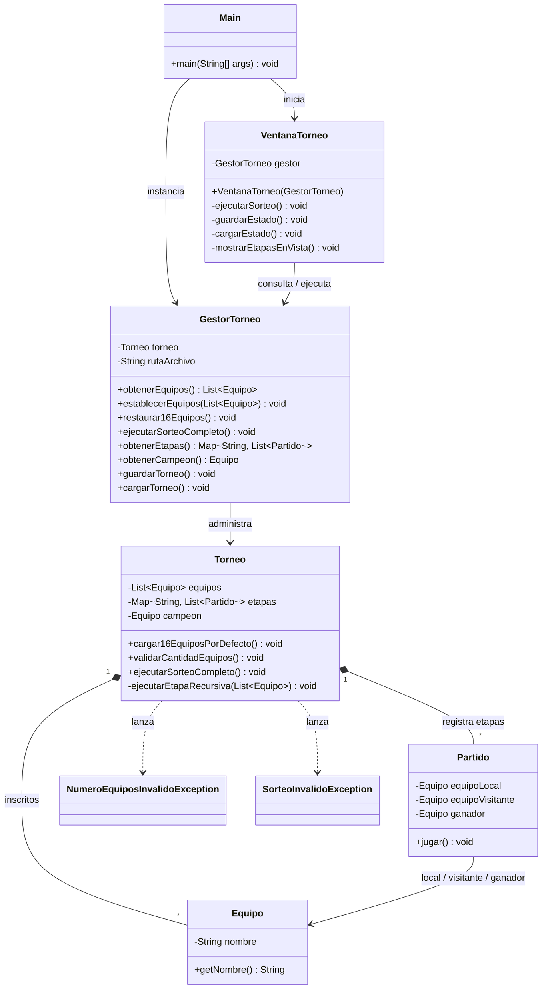

# Liga Profesional - Sistema de Gestión de Torneos (MVC en Java)

Aplicación de escritorio desarrollada en **Java (Swing)** bajo el patrón arquitectónico **Modelo-Vista-Controlador (MVC)** para la simulación recursiva de torneos de eliminación directa (desde Octavos de final hasta la Final), con manejo de excepciones personalizadas y persistencia mediante serialización binaria.

## Características Principales

* **Arquitectura MVC:** Separación estricta entre lógica de dominio (`modelo`), control de flujo y persistencia (`controlador`), interfaz gráfica (`vista`) y validación de reglas (`excepciones`).
* **Sorteo Recursivo:** Emparejamiento aleatorio y resolución automática de rondas sucesivas (`Octavos de final` -> `Cuartos de final` -> `Semifinales` -> `Final`) hasta determinar un único campeón.
* **Validación con Excepciones Personalizadas:**
  * `NumeroEquiposInvalidoException`: Verifica que la cantidad de participantes sea al menos 2 y corresponda a una potencia de dos (2, 4, 8, 16, ...).
  * `SorteoInvalidoException`: Impide cruces duplicados o que un equipo se enfrente a sí mismo dentro de una misma etapa.
* **Persistencia de Datos:** Guardado y carga del estado completo del torneo en el archivo binario `torneo.ser` (`Serializable`).
* **Interfaz Gráfica Oscura (Swing):** Gestión dinámica de clubes (agregar, eliminar y restaurar 16 equipos por defecto), visualización global en pestaña *Flujo Completo* y pestañas dinámicas por cada ronda disputada.

## Arquitectura y Diagrama de Clases



## Estructura del Proyecto

```text
├── README.md
└── src/
    ├── Main.java
    ├── controlador/
    │   └── GestorTorneo.java
    ├── excepciones/
    │   ├── NumeroEquiposInvalidoException.java
    │   └── SorteoInvalidoException.java
    ├── modelo/
    │   ├── Equipo.java
    │   ├── Partido.java
    │   └── Torneo.java
    └── vista/
        └── VentanaTorneo.java
```

## Requisitos y Ejecución

* **JDK:** Java 17 o superior.
* **IDE compatible:** Eclipse, Visual Studio Code o IntelliJ IDEA.

### Pasos para ejecutar

1. Clona este repositorio o descarga el código fuente:
   ```bash
   git clone <URL_DE_TU_REPOSITORIO>
   ```
2. Abre el proyecto en tu IDE apuntando a la carpeta `src` como directorio fuente.
3. Ejecuta la clase `Main.java`.
4. En la ventana principal, utiliza **Ejecutar Sorteo Completo** para simular el torneo, **Guardar (torneo.ser)** para exportar el progreso y **Cargar (torneo.ser)** para recuperarlo.
```
